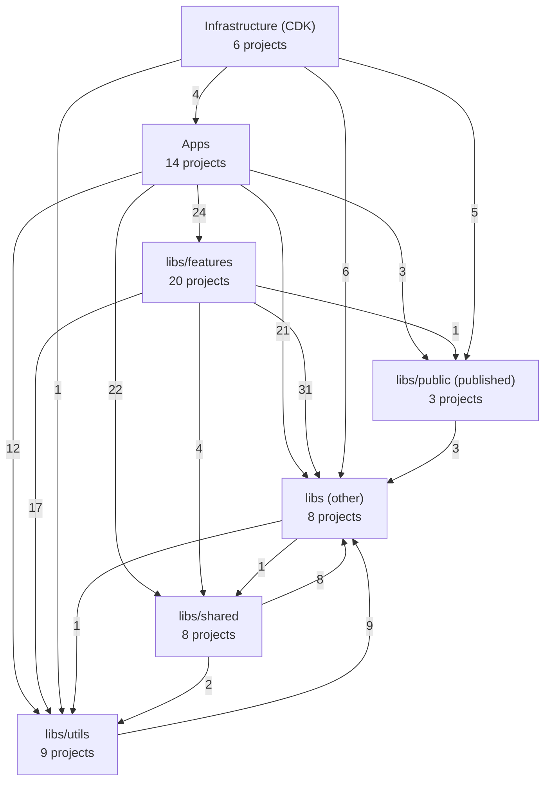
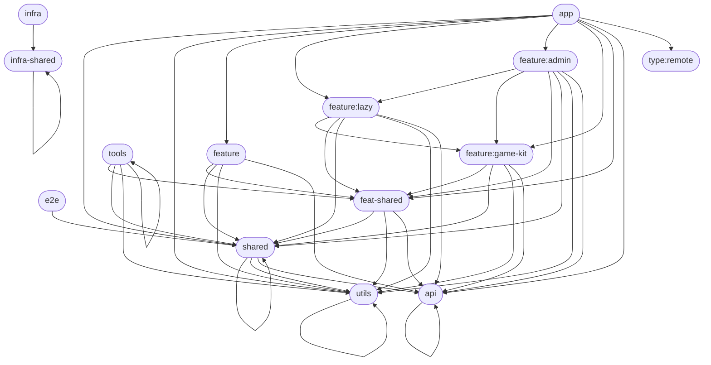
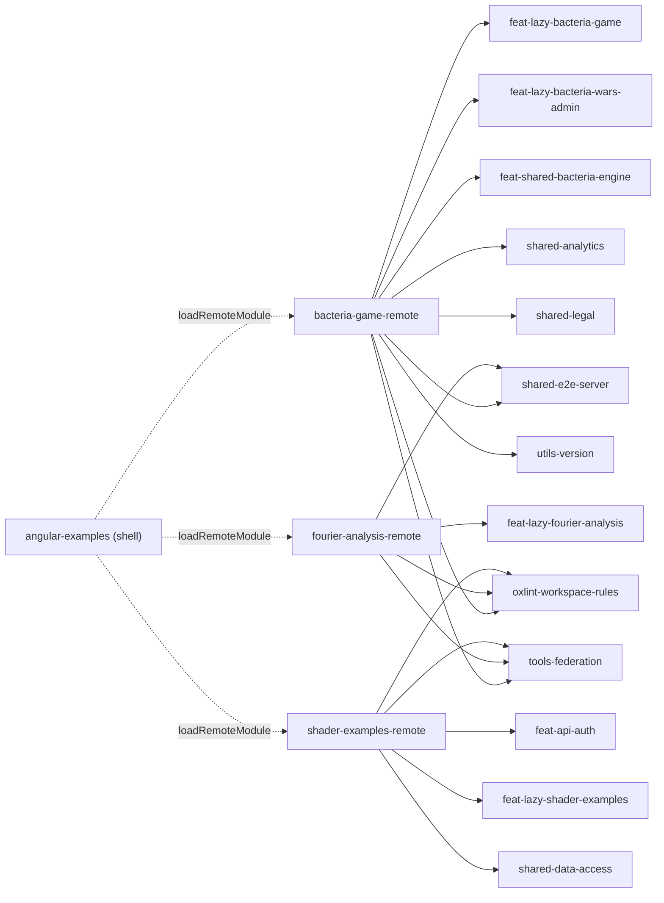

<!-- Generated by tools/architecture/generate-diagrams.mjs. Do not edit by hand: run `npm run arch:diagrams`. -->

# Architecture Diagrams

Generated from the Nx project graph, the module boundary rules in
`.oxlintrc.json` and the Native Federation manifest. Regenerated every week by
the architecture routine; for the narrative overview see
[`docs/ARCHITECTURE.md`](../ARCHITECTURE.md).

**68 projects · 198 internal dependencies · 3 federated remotes**

## Contents

- [Layer overview](#layer-overview)
- [Allowed dependencies (module boundaries)](#allowed-dependencies-module-boundaries)
- [Module Federation topology](#module-federation-topology)
- [Project dependency graph](#project-dependency-graph)
- [Modularity metrics](#modularity-metrics)
- [Automated findings](#automated-findings)

## Layer overview

Dependencies between project groups (edge label = number of project-level
dependencies).

## Allowed dependencies (module boundaries)

Tag rules enforced by `@nx/enforce-module-boundaries`. An arrow means
"projects tagged A may depend on projects tagged B". A tag may only depend on itself where its
own rule lists it (drawn as a self-loop).

## Module Federation topology

## Project dependency graph

Solid arrows are static imports, dotted arrows are lazy (dynamic) imports and
thick arrows are implicit dependencies from `project.json` (e.g. a CDK stack
deploying an app). npm packages are not shown.

```mermaid
flowchart LR
  subgraph infra["Infrastructure (CDK)"]
    angular_examples_cdk["angular-examples-cdk"]
    bacteria_game_remote_cdk["bacteria-game-remote-cdk"]
    fourier_analysis_remote_cdk["fourier-analysis-remote-cdk"]
    korbjaeger_cdk["korbjaeger-cdk"]
    portfolio_cdk["portfolio-cdk"]
    shader_examples_remote_cdk["shader-examples-remote-cdk"]
  end
  subgraph apps["Apps"]
    angular_examples["angular-examples"]
    bacteria_game_remote["bacteria-game-remote"]
    bacteria_wars_android["bacteria-wars-android"]
    bacteria_wars_functions["bacteria-wars-functions"]
    fourier_analysis_remote["fourier-analysis-remote"]
    korbjaeger["korbjaeger"]
    korbjaeger_functions["korbjaeger-functions"]
    nx_aws_cdk_v2_e2e["nx-aws-cdk-v2-e2e"]
    pacetrainer["pacetrainer"]
    portfolio["portfolio"]
    rollapolla_analog["rollapolla-analog"]
    shader_examples_remote["shader-examples-remote"]
    tools["tools"]
    ws_thanos_test_app["ws-thanos-test-app"]
  end
  subgraph public["libs/public (published)"]
    nx_aws_cdk_v2["nx-aws-cdk-v2"]
    spa_cdk_stack["spa-cdk-stack"]
    ws_thanos["ws-thanos"]
  end
  subgraph features["libs/features"]
    feat_api_auth["feat-api-auth"]
    feat_bacteria_rendering["feat-bacteria-rendering"]
    feat_korbjaeger_answers["feat-korbjaeger-answers"]
    feat_korbjaeger_selection["feat-korbjaeger-selection"]
    feat_lazy_bacteria_game["feat-lazy-bacteria-game"]
    feat_lazy_bacteria_wars_admin["feat-lazy-bacteria-wars-admin"]
    feat_lazy_fourier_analysis["feat-lazy-fourier-analysis"]
    feat_lazy_gravity_rocks["feat-lazy-gravity-rocks"]
    feat_lazy_poisson["feat-lazy-poisson"]
    feat_lazy_react_diff["feat-lazy-react-diff"]
    feat_lazy_shader_examples["feat-lazy-shader-examples"]
    feat_lazy_some_gpu_calculation["feat-lazy-some-gpu-calculation"]
    feat_lazy_tf_examples["feat-lazy-tf-examples"]
    feat_lazy_wasm_test["feat-lazy-wasm-test"]
    feat_lazy_web_gl["feat-lazy-web-gl"]
    feat_shared_bacteria_engine["feat-shared-bacteria-engine"]
    feat_shared_basketball_data["feat-shared-basketball-data"]
    feat_shared_korbjaeger_account["feat-shared-korbjaeger-account"]
    feat_shared_reaction_diffusion_kernels["feat-shared-reaction-diffusion-kernels"]
    neural_networks["neural-networks"]
  end
  subgraph shared["libs/shared"]
    headline_animation["headline-animation"]
    shared_analytics["shared-analytics"]
    shared_data_access["shared-data-access"]
    shared_e2e_server["shared-e2e-server"]
    shared_firebase_emulator["shared-firebase-emulator"]
    shared_legal["shared-legal"]
    shared_theme["shared-theme"]
    ws_gl["ws-gl"]
  end
  subgraph utils["libs/utils"]
    math["math"]
    utils_browser_storage["utils-browser-storage"]
    utils_decorators["utils-decorators"]
    utils_gpu_calc["utils-gpu-calc"]
    utils_json["utils-json"]
    utils_measure_fps["utils-measure-fps"]
    utils_operators["utils-operators"]
    utils_time["utils-time"]
    utils_version["utils-version"]
  end
  subgraph other["libs (other)"]
    fib_wasm["fib-wasm"]
    fib_wasm_api["fib-wasm-api"]
    oxlint_workspace_rules["oxlint-workspace-rules"]
    test_helper["test-helper"]
    tools_deploy["tools-deploy"]
    tools_federation["tools-federation"]
    tools_vite["tools-vite"]
    ui_kit["ui-kit"]
  end
  angular_examples --> bacteria_game_remote
  angular_examples --> feat_api_auth
  angular_examples -.-> feat_lazy_gravity_rocks
  angular_examples -.-> feat_lazy_poisson
  angular_examples -.-> feat_lazy_react_diff
  angular_examples -.-> feat_lazy_some_gpu_calculation
  angular_examples -.-> feat_lazy_tf_examples
  angular_examples -.-> feat_lazy_wasm_test
  angular_examples -.-> feat_lazy_web_gl
  angular_examples --> fourier_analysis_remote
  angular_examples --> headline_animation
  angular_examples -.-> neural_networks
  angular_examples ==> oxlint_workspace_rules
  angular_examples --> shader_examples_remote
  angular_examples --> shared_data_access
  angular_examples --> tools_federation
  angular_examples --> ui_kit
  angular_examples --> ws_gl
  angular_examples --> ws_thanos
  angular_examples_cdk ==> angular_examples
  angular_examples_cdk ==> oxlint_workspace_rules
  angular_examples_cdk --> spa_cdk_stack
  angular_examples_cdk --> utils_version
  bacteria_game_remote --> feat_lazy_bacteria_game
  bacteria_game_remote -.-> feat_lazy_bacteria_wars_admin
  bacteria_game_remote --> feat_shared_bacteria_engine
  bacteria_game_remote ==> oxlint_workspace_rules
  bacteria_game_remote --> shared_analytics
  bacteria_game_remote --> shared_e2e_server
  bacteria_game_remote --> shared_legal
  bacteria_game_remote --> tools_federation
  bacteria_game_remote --> utils_version
  bacteria_game_remote_cdk ==> oxlint_workspace_rules
  bacteria_wars_functions --> feat_shared_bacteria_engine
  bacteria_wars_functions ==> oxlint_workspace_rules
  bacteria_wars_functions --> shared_firebase_emulator
  bacteria_wars_functions --> utils_version
  feat_api_auth ==> oxlint_workspace_rules
  feat_bacteria_rendering --> feat_shared_bacteria_engine
  feat_bacteria_rendering ==> oxlint_workspace_rules
  feat_korbjaeger_answers --> feat_shared_basketball_data
  feat_korbjaeger_answers ==> oxlint_workspace_rules
  feat_korbjaeger_answers --> utils_browser_storage
  feat_korbjaeger_selection --> feat_shared_basketball_data
  feat_korbjaeger_selection --> feat_shared_korbjaeger_account
  feat_korbjaeger_selection ==> oxlint_workspace_rules
  feat_korbjaeger_selection --> utils_browser_storage
  feat_lazy_bacteria_game --> feat_bacteria_rendering
  feat_lazy_bacteria_game --> feat_shared_bacteria_engine
  feat_lazy_bacteria_game ==> oxlint_workspace_rules
  feat_lazy_bacteria_game --> shared_analytics
  feat_lazy_bacteria_game --> ui_kit
  feat_lazy_bacteria_game --> utils_browser_storage
  feat_lazy_bacteria_game --> utils_json
  feat_lazy_bacteria_game --> utils_measure_fps
  feat_lazy_bacteria_game --> ws_thanos
  feat_lazy_bacteria_wars_admin --> feat_lazy_bacteria_game
  feat_lazy_bacteria_wars_admin ==> oxlint_workspace_rules
  feat_lazy_fourier_analysis ==> oxlint_workspace_rules
  feat_lazy_fourier_analysis --> ui_kit
  feat_lazy_gravity_rocks --> math
  feat_lazy_gravity_rocks ==> oxlint_workspace_rules
  feat_lazy_gravity_rocks --> test_helper
  feat_lazy_gravity_rocks --> utils_operators
  feat_lazy_poisson --> math
  feat_lazy_poisson ==> oxlint_workspace_rules
  feat_lazy_poisson --> ui_kit
  feat_lazy_poisson --> utils_measure_fps
  feat_lazy_react_diff --> feat_shared_reaction_diffusion_kernels
  feat_lazy_react_diff --> headline_animation
  feat_lazy_react_diff ==> oxlint_workspace_rules
  feat_lazy_react_diff --> ui_kit
  feat_lazy_react_diff --> utils_gpu_calc
  feat_lazy_react_diff --> utils_operators
  feat_lazy_shader_examples --> feat_api_auth
  feat_lazy_shader_examples ==> oxlint_workspace_rules
  feat_lazy_shader_examples --> shared_data_access
  feat_lazy_shader_examples --> ui_kit
  feat_lazy_some_gpu_calculation ==> oxlint_workspace_rules
  feat_lazy_some_gpu_calculation --> ui_kit
  feat_lazy_some_gpu_calculation --> utils_gpu_calc
  feat_lazy_some_gpu_calculation --> utils_measure_fps
  feat_lazy_some_gpu_calculation --> utils_operators
  feat_lazy_tf_examples --> headline_animation
  feat_lazy_tf_examples ==> oxlint_workspace_rules
  feat_lazy_tf_examples --> ui_kit
  feat_lazy_wasm_test --> fib_wasm_api
  feat_lazy_wasm_test ==> oxlint_workspace_rules
  feat_lazy_wasm_test --> utils_decorators
  feat_lazy_web_gl ==> oxlint_workspace_rules
  feat_lazy_web_gl --> ui_kit
  feat_shared_bacteria_engine ==> oxlint_workspace_rules
  feat_shared_basketball_data ==> oxlint_workspace_rules
  feat_shared_korbjaeger_account ==> oxlint_workspace_rules
  feat_shared_korbjaeger_account --> utils_time
  feat_shared_reaction_diffusion_kernels ==> oxlint_workspace_rules
  feat_shared_reaction_diffusion_kernels --> utils_gpu_calc
  fib_wasm ==> oxlint_workspace_rules
  fib_wasm_api ==> fib_wasm
  fib_wasm_api ==> oxlint_workspace_rules
  fourier_analysis_remote -.-> feat_lazy_fourier_analysis
  fourier_analysis_remote ==> oxlint_workspace_rules
  fourier_analysis_remote --> shared_e2e_server
  fourier_analysis_remote --> tools_federation
  fourier_analysis_remote_cdk ==> fourier_analysis_remote
  fourier_analysis_remote_cdk ==> oxlint_workspace_rules
  fourier_analysis_remote_cdk --> spa_cdk_stack
  headline_animation ==> oxlint_workspace_rules
  korbjaeger --> feat_korbjaeger_answers
  korbjaeger --> feat_korbjaeger_selection
  korbjaeger --> feat_shared_basketball_data
  korbjaeger --> feat_shared_korbjaeger_account
  korbjaeger ==> oxlint_workspace_rules
  korbjaeger --> shared_e2e_server
  korbjaeger --> shared_firebase_emulator
  korbjaeger --> shared_legal
  korbjaeger --> shared_theme
  korbjaeger --> tools_vite
  korbjaeger --> utils_browser_storage
  korbjaeger --> utils_time
  korbjaeger --> utils_version
  korbjaeger_cdk ==> oxlint_workspace_rules
  korbjaeger_cdk --> spa_cdk_stack
  korbjaeger_functions --> feat_shared_basketball_data
  korbjaeger_functions --> feat_shared_korbjaeger_account
  korbjaeger_functions ==> oxlint_workspace_rules
  korbjaeger_functions --> shared_firebase_emulator
  korbjaeger_functions --> utils_time
  math ==> oxlint_workspace_rules
  neural_networks ==> oxlint_workspace_rules
  neural_networks --> ui_kit
  nx_aws_cdk_v2 ==> oxlint_workspace_rules
  nx_aws_cdk_v2_e2e ==> nx_aws_cdk_v2
  nx_aws_cdk_v2_e2e ==> oxlint_workspace_rules
  pacetrainer ==> oxlint_workspace_rules
  pacetrainer --> shared_e2e_server
  pacetrainer --> tools_vite
  pacetrainer --> utils_browser_storage
  pacetrainer --> utils_json
  pacetrainer --> utils_time
  portfolio ==> angular_examples
  portfolio ==> oxlint_workspace_rules
  portfolio --> shared_legal
  portfolio --> shared_theme
  portfolio --> utils_browser_storage
  portfolio_cdk ==> oxlint_workspace_rules
  portfolio_cdk ==> portfolio
  portfolio_cdk --> spa_cdk_stack
  rollapolla_analog ==> oxlint_workspace_rules
  rollapolla_analog --> shared_analytics
  rollapolla_analog --> shared_data_access
  rollapolla_analog --> shared_e2e_server
  rollapolla_analog --> shared_legal
  rollapolla_analog --> tools_vite
  rollapolla_analog --> utils_browser_storage
  shader_examples_remote --> feat_api_auth
  shader_examples_remote --> feat_lazy_shader_examples
  shader_examples_remote ==> oxlint_workspace_rules
  shader_examples_remote --> shared_data_access
  shader_examples_remote --> tools_federation
  shader_examples_remote_cdk ==> oxlint_workspace_rules
  shader_examples_remote_cdk ==> shader_examples_remote
  shader_examples_remote_cdk --> spa_cdk_stack
  shared_analytics ==> oxlint_workspace_rules
  shared_analytics --> utils_browser_storage
  shared_data_access ==> oxlint_workspace_rules
  shared_e2e_server ==> oxlint_workspace_rules
  shared_firebase_emulator ==> oxlint_workspace_rules
  shared_legal ==> oxlint_workspace_rules
  shared_theme ==> oxlint_workspace_rules
  shared_theme --> utils_browser_storage
  spa_cdk_stack ==> oxlint_workspace_rules
  test_helper ==> oxlint_workspace_rules
  tools --> feat_shared_bacteria_engine
  tools --> feat_shared_basketball_data
  tools ==> oxlint_workspace_rules
  tools --> utils_version
  tools_deploy ==> oxlint_workspace_rules
  tools_federation ==> oxlint_workspace_rules
  tools_vite ==> oxlint_workspace_rules
  ui_kit ==> oxlint_workspace_rules
  ui_kit --> utils_measure_fps
  ui_kit --> ws_gl
  utils_browser_storage ==> oxlint_workspace_rules
  utils_browser_storage --> utils_json
  utils_decorators ==> oxlint_workspace_rules
  utils_gpu_calc ==> oxlint_workspace_rules
  utils_json ==> oxlint_workspace_rules
  utils_measure_fps ==> oxlint_workspace_rules
  utils_measure_fps --> utils_operators
  utils_operators ==> oxlint_workspace_rules
  utils_time ==> oxlint_workspace_rules
  utils_version ==> oxlint_workspace_rules
  ws_gl ==> oxlint_workspace_rules
  ws_thanos ==> oxlint_workspace_rules
  ws_thanos_test_app ==> oxlint_workspace_rules
  ws_thanos_test_app --> shared_e2e_server
  ws_thanos_test_app --> ws_thanos
```

## Modularity metrics

- **Fan-in (Ca)**: projects that depend on this one.
- **Fan-out (Ce)**: projects this one depends on.
- **Instability** = Ce / (Ca + Ce). Stable, widely used libraries should sit
  near 0; apps near 1. A library with high instability _and_ high fan-in is a
  change magnet.

| Project                                  | Group    | Tags                                    | Fan-in (Ca) | Fan-out (Ce) | Instability |
| ---------------------------------------- | -------- | --------------------------------------- | ----------- | ------------ | ----------- |
| `oxlint-workspace-rules`                 | other    | tools                                   | 66          | 0            | 0           |
| `angular-examples`                       | apps     | app, type:host                          | 2           | 19           | 0.9         |
| `korbjaeger`                             | apps     | app, type:firebase                      | 0           | 13           | 1           |
| `ui-kit`                                 | other    | shared, ui                              | 10          | 3            | 0.23        |
| `feat-lazy-bacteria-game`                | features | feature:lazy                            | 2           | 9            | 0.82        |
| `utils-browser-storage`                  | utils    | utils                                   | 9           | 2            | 0.18        |
| `bacteria-game-remote`                   | apps     | app, type:firebase, type:remote         | 1           | 9            | 0.9         |
| `feat-lazy-react-diff`                   | features | feature:lazy                            | 1           | 6            | 0.86        |
| `rollapolla-analog`                      | apps     | app, type:firebase                      | 0           | 7            | 1           |
| `shader-examples-remote`                 | apps     | app, scope:shader-examples, type:remote | 2           | 5            | 0.71        |
| `shared-e2e-server`                      | shared   | shared                                  | 6           | 1            | 0.14        |
| `feat-lazy-some-gpu-calculation`         | features | feature:lazy                            | 1           | 5            | 0.83        |
| `feat-shared-bacteria-engine`            | features | feat-shared                             | 5           | 1            | 0.17        |
| `feat-shared-basketball-data`            | features | feat-shared                             | 5           | 1            | 0.17        |
| `fourier-analysis-remote`                | apps     | app, type:remote                        | 2           | 4            | 0.67        |
| `pacetrainer`                            | apps     | app, type:firebase                      | 0           | 6            | 1           |
| `portfolio`                              | apps     | app, type:portfolio                     | 1           | 5            | 0.83        |
| `spa-cdk-stack`                          | public   | infra-shared, published                 | 5           | 1            | 0.17        |
| `utils-measure-fps`                      | utils    | utils                                   | 4           | 2            | 0.33        |
| `utils-version`                          | utils    | infra-shared, utils                     | 5           | 1            | 0.17        |
| `feat-korbjaeger-selection`              | features | feature                                 | 1           | 4            | 0.8         |
| `feat-lazy-gravity-rocks`                | features | feature:lazy                            | 1           | 4            | 0.8         |
| `feat-lazy-poisson`                      | features | feature:lazy                            | 1           | 4            | 0.8         |
| `feat-lazy-shader-examples`              | features | feature:lazy                            | 1           | 4            | 0.8         |
| `feat-shared-korbjaeger-account`         | features | feat-shared                             | 3           | 2            | 0.4         |
| `korbjaeger-functions`                   | apps     | app, type:firebase, type:functions      | 0           | 5            | 1           |
| `shared-analytics`                       | shared   | shared                                  | 3           | 2            | 0.4         |
| `shared-data-access`                     | shared   | shared                                  | 4           | 1            | 0.2         |
| `shared-legal`                           | shared   | shared                                  | 4           | 1            | 0.2         |
| `tools-federation`                       | other    | tools                                   | 4           | 1            | 0.2         |
| `utils-operators`                        | utils    | utils                                   | 4           | 1            | 0.2         |
| `utils-time`                             | utils    | utils                                   | 4           | 1            | 0.2         |
| `bacteria-wars-functions`                | apps     | app, type:firebase, type:functions      | 0           | 4            | 1           |
| `feat-api-auth`                          | features | api                                     | 3           | 1            | 0.25        |
| `feat-korbjaeger-answers`                | features | feature                                 | 1           | 3            | 0.75        |
| `feat-lazy-tf-examples`                  | features | feature:lazy                            | 1           | 3            | 0.75        |
| `feat-lazy-wasm-test`                    | features | feature:lazy                            | 1           | 3            | 0.75        |
| `headline-animation`                     | shared   | shared                                  | 3           | 1            | 0.25        |
| `shared-firebase-emulator`               | shared   | shared                                  | 3           | 1            | 0.25        |
| `shared-theme`                           | shared   | shared                                  | 2           | 2            | 0.5         |
| `tools`                                  | apps     | tools                                   | 0           | 4            | 1           |
| `tools-vite`                             | other    | tools                                   | 3           | 1            | 0.25        |
| `utils-gpu-calc`                         | utils    | utils                                   | 3           | 1            | 0.25        |
| `utils-json`                             | utils    | utils                                   | 3           | 1            | 0.25        |
| `ws-thanos`                              | public   | published, shared, ui                   | 3           | 1            | 0.25        |
| `feat-bacteria-rendering`                | features | feature:game-kit                        | 1           | 2            | 0.67        |
| `feat-lazy-bacteria-wars-admin`          | features | feature:admin                           | 1           | 2            | 0.67        |
| `feat-lazy-fourier-analysis`             | features | feature:lazy                            | 1           | 2            | 0.67        |
| `feat-lazy-web-gl`                       | features | feature:lazy                            | 1           | 2            | 0.67        |
| `feat-shared-reaction-diffusion-kernels` | features | feat-shared                             | 1           | 2            | 0.67        |
| `fib-wasm-api`                           | other    | api                                     | 1           | 2            | 0.67        |
| `math`                                   | utils    | utils                                   | 2           | 1            | 0.33        |
| `neural-networks`                        | features | feature:lazy                            | 1           | 2            | 0.67        |
| `ws-gl`                                  | shared   | shared                                  | 2           | 1            | 0.33        |
| `ws-thanos-test-app`                     | apps     | app, type:test-app                      | 0           | 3            | 1           |
| `fib-wasm`                               | other    | shared                                  | 1           | 1            | 0.5         |
| `nx-aws-cdk-v2`                          | public   | infra-shared, published                 | 1           | 1            | 0.5         |
| `nx-aws-cdk-v2-e2e`                      | apps     | e2e                                     | 0           | 2            | 1           |
| `test-helper`                            | other    | shared                                  | 1           | 1            | 0.5         |
| `utils-decorators`                       | utils    | utils                                   | 1           | 1            | 0.5         |
| `tools-deploy`                           | other    | tools                                   | 0           | 1            | 1           |
| `bacteria-wars-android`                  | apps     | type:android                            | 0           | 0            | –           |

## Automated findings

- **Circular dependencies:** none
- **Tag constraint violations** (`.oxlintrc.json`): 7
  - `angular-examples` → `tools-federation` (`app` may only use `shared`, `utils`, `feature`, `feature:lazy`, `feature:admin`, `feature:game-kit`, `feat-shared`, `api`, `type:remote`)
  - `bacteria-game-remote` → `tools-federation` (`app` may only use `shared`, `utils`, `feature`, `feature:lazy`, `feature:admin`, `feature:game-kit`, `feat-shared`, `api`, `type:remote`)
  - `fourier-analysis-remote` → `tools-federation` (`app` may only use `shared`, `utils`, `feature`, `feature:lazy`, `feature:admin`, `feature:game-kit`, `feat-shared`, `api`, `type:remote`)
  - `korbjaeger` → `tools-vite` (`app` may only use `shared`, `utils`, `feature`, `feature:lazy`, `feature:admin`, `feature:game-kit`, `feat-shared`, `api`, `type:remote`)
  - `pacetrainer` → `tools-vite` (`app` may only use `shared`, `utils`, `feature`, `feature:lazy`, `feature:admin`, `feature:game-kit`, `feat-shared`, `api`, `type:remote`)
  - `rollapolla-analog` → `tools-vite` (`app` may only use `shared`, `utils`, `feature`, `feature:lazy`, `feature:admin`, `feature:game-kit`, `feat-shared`, `api`, `type:remote`)
  - `shader-examples-remote` → `tools-federation` (`app` may only use `shared`, `utils`, `feature`, `feature:lazy`, `feature:admin`, `feature:game-kit`, `feat-shared`, `api`, `type:remote`)
- **Unused libraries** (no project depends on them): 1
  - `tools-deploy`
- **Projects without tags:** none
- **Libraries with high fan-out (≥ 5):** 3
  - `feat-lazy-bacteria-game` (9)
  - `feat-lazy-react-diff` (6)
  - `feat-lazy-some-gpu-calculation` (5)
